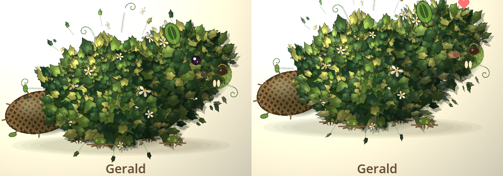

# HedgePets

A garden game in Godot 4.7 (GL Compatibility, portrait 1080 × 1920), played on the web at go.fridge.run/hedgepets.
Creatures made of plants - hedgepets, modelled on New England animals - come to an ordinary back garden at the edge
of the woods if you grow and build what they like. A place, not a treadmill: watching is valid play.



## Where to start

| You want to | Read |
|---|---|
| Understand how the code is built, and why | [docs/ARCHITECTURE.md](docs/ARCHITECTURE.md) |
| Run it, check it, deploy it | [docs/OPERATIONS.md](docs/OPERATIONS.md) |
| Change it (the rules) | [AGENTS.md](AGENTS.md), [docs/CODE_REVIEW.md](docs/CODE_REVIEW.md) |
| The garden's gameplay | [docs/GARDEN.md](docs/GARDEN.md), [docs/BACKYARD.md](docs/BACKYARD.md) |
| The woods and the nursery | [docs/NURSERY.md](docs/NURSERY.md) |
| How pets look | [docs/ART_DIRECTION.md](docs/ART_DIRECTION.md) |
| Motion and transitions | [docs/MOTION.md](docs/MOTION.md) |
| Phones and the web build | [docs/MOBILE.md](docs/MOBILE.md) |
| Where things stand today | [docs/HANDOFF.md](docs/HANDOFF.md) |

## Running

```
godot --path .                      # the game (garden.tscn)
godot --path . res://main3d.tscn    # the pet viewer
godot --path . res://world_editor.tscn
godot --path . -e res://tools/art/tree_lab.tscn   # tune the trees in the editor
```

Checks are in `tools/checks/` (run headless; see OPERATIONS.md). Offscreen runs always take `--audio-driver Dummy`.

## Credits

Third-party assets and their licences: [docs/CREDITS.md](docs/CREDITS.md).
