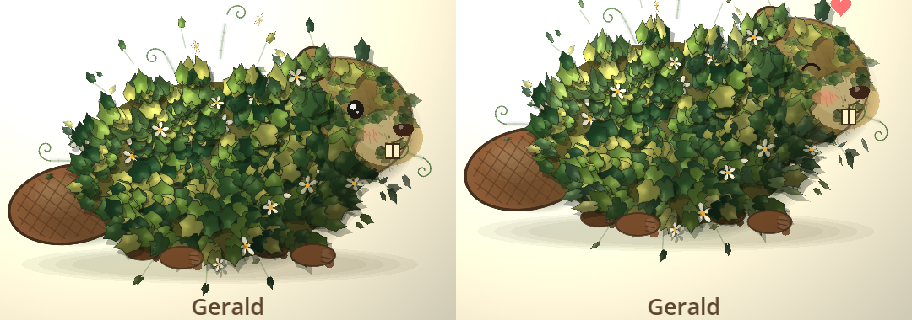
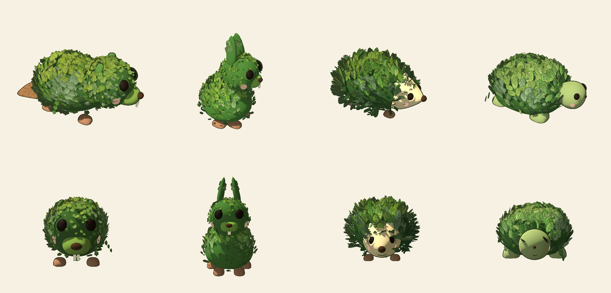
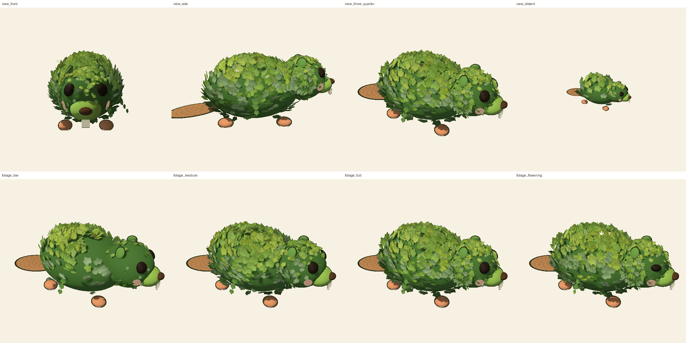
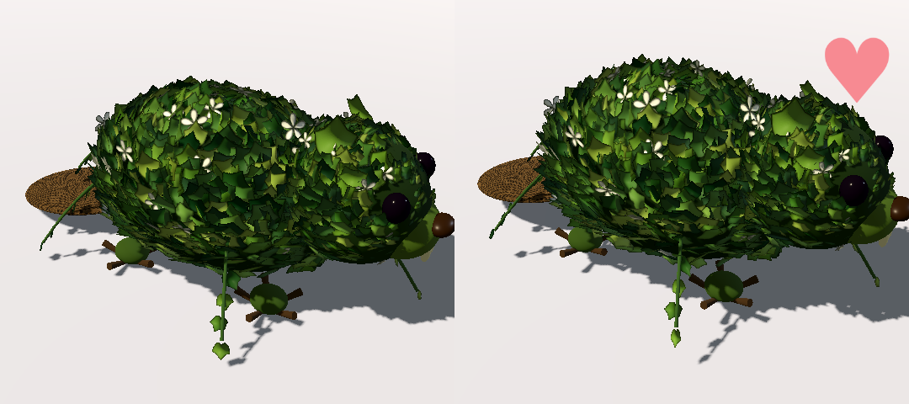

# HedgePets

A tiny Godot 4.7 (GL Compatibility, portrait 1080 × 1920) garden-creature lab. The design notes are
`hedgepets, part.md` ("we're going to care about these things way too much").



## The garden (the main scene, `garden.tscn`)

A messy back garden: clear junk 🪏, plant and water 🌱💧, and pets peek through the broken fence, visit, then move in
when the garden suits them. **[docs/GARDEN.md](docs/GARDEN.md).** Transitions: **[docs/MOTION.md](docs/MOTION.md)**. Mobile / web export: **[docs/MOBILE.md](docs/MOBILE.md)**.

## Gerald in 3D (the pet viewer, `main3d.tscn`)

**Art direction, parameters and acceptance: [docs/ART_DIRECTION.md](docs/ART_DIRECTION.md).** Developer view: F1.

**Pets:** Gerald (beaver, ivy), Clover (sitting bunny, clover, a cotton tail of blossom), Juniper (hedgehog, fern),
Bramble (tortoise, a flowering jasmine shell), Spruce (moose, pine, wooden paddle antlers), Hazel (squirrel, autumn oak
with acorns, a huge tail), Smudge (raccoon, silvery sage, a mask and a ringed tail), plus 40 New England animals
made from data (`pets/species.json` via `scripts/art/species_builder.gd`; see docs/GARDEN.md) - each a profile in `pets/*.tres` on the same renderer. Switch with ‹ ›
or the arrow keys. **Drag** to turn the pet (turntable with momentum), drag up/down to tilt, **wheel** to zoom, **tap**
for a hop and a heart.






Seen from above and to the side like `hedgepetsGoal.jpg`. Everything is built in `scripts/hedge_pet_3d.gd`: leafy
masses for the body and head (deep shade inside, no fur), about 2,000 ivy leaves as MultiMeshes placed on the
surface (the same sprites and normal maps as the 2D version), vines hanging off his sides, a woven-twig tail, root
feet, berry eyes, a seed nose and seed teeth, leaf ears, a warm sun with real shadows. The wind runs on the GPU
(`shaders/leaf.gdshader`): gusts roll across him, leaves bend, flutter and twist. He blinks, turns his head a little
toward your pointer, and hops with a heart when you tap him. ~59 fps.



The 2D version is still `main.tscn` (open it in the editor, or set it as the main scene).

## What is here (2D)

- **Gerald**, a fully botanical beaver - a plant in the shape of a beaver, not an animal under plants - seen
  three-quarters (the target is `hedgepetsGoal.jpg`). Base layer (`scripts/hedge_pet.gd`): a paddle tail of woven twigs
  with leaves sprouting from its edge, root clumps for feet, deep leafy shade under the ivy (no fur anywhere), moss over
  the muzzle. Top layer: a glossy berry eye, a seed nose, two pale seed teeth, a vine mouth, a cupped-leaf ear.
- **The ivy** (`scripts/growth_renderer.gd`): an ivy cover over the body and the back of the head, vines from the
  growth curves trailing off the edges with curling tendrils, white flowers. Every leaf is lit by where it sits on the
  round body and foreshortened at the rim. The layout is built once; every frame the leaves rustle in a wind that
  rolls across him (rim leaves most; a tap shivers them all). Leaves are baked sprites
  (`assets/sprites/*.png` from `tools/bake_leaf_sprites.py`; real lobed ivy from `tools/make_ivy_sprites.py`), so 670
  rustling leaves run at the display's frame rate.
- **Light and shadow** (Godot 2D lighting): every leaf sprite has a normal map (`tools/make_normal_maps.py`: a
  gentle dome and pressed-in veins) and is drawn as a `CanvasTexture`; a warm `PointLight2D` ("Sun") from the upper
  left over a slightly dimmed `CanvasModulate` shapes each leaf, and leaves glint as they turn. Each leaf on the body
  drops a soft shadow on whatever lies beneath it.
- **Realistic wind**: a breeze plus gusts that roll across him left to right (`wind_at()`); leaves bend with it,
  flutter on their stems, lift, and twist so their paler edge shows for a moment; deep leaves barely move. A strong
  gust or a tap sends a small shiver through him.
- **He is alive** (`scripts/pet_life.gd`): breathes (barely), blinks, follows your pointer with his eye and glances
  around when you're idle; every so often a gust goes through his leaves; tap him and he hops, his eye squeezes shut,
  his cheek flushes and a heart pops out. He himself does not sway - the leaves do.
- **The renderer lab** (growth, amplitude, frequency, leaf spacing, overflow, plant): press **Tab**.

## Checking it without a window

```
xvfb-run -a -s "-screen 0 1080x1920x24" godot --path . --rendering-driver opengl3 --script tools/capture_screenshot.gd   # /tmp/hedgepets-headless.png
xvfb-run -a -s "-screen 0 1080x1920x24" godot --path . --rendering-driver opengl3 --script tools/capture_frames.gd       # 6 frames with a tap
DISPLAY=:0 godot --path . --script tools/fps_check.gd                                                                        # frame rate on the real GPU
```
